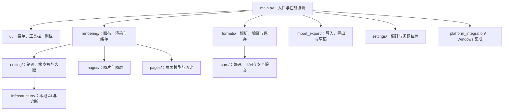

# NotabilityEditor 0.7.6-Beta

NotabilityEditor 是面向 Notability 笔记的 Windows 本地编辑器，基于 GitHub 上 NotabilityViewer 的笔记预览能力扩展开发，将笔记查看、手写批注、图片编辑、页面管理和 PDF 转换整合到同一应用中。

项目面向 Notability 的 **NTB** 和 **NOTE** 两种笔记格式。当前支持 NTB 的编辑与保存，以及 NOTE 的阅读与导出；同时支持创建 NTB 笔记、导入 PDF 创建笔记和导出 PDF。

本项目是独立开发的工具，与官方 Notability 客户端无隶属关系。

## 功能概览

| 功能 | 说明 |
| --- | --- |
| 笔记预览 | 打开 NTB、NOTE 笔记，显示受支持的笔迹、图片和页面内容。 |
| NTB 编辑 | 使用画笔、荧光笔和橡皮擦编辑笔迹，支持保存及另存为。 |
| 图片上批注 | 新画笔迹和荧光笔默认位于图片上方，保存重开和 PDF 导出保持图层顺序。 |
| 笔迹选取 | 矩形或自由形状选取，支持移动、跨页拖动、删除、Shift 追加及 Alt 减选。 |
| 选取辅助 | 提供精确选取、完整包含、几何补全和本地 AI 辅助，可分别筛选普通笔迹与荧光笔。 |
| 图片编辑 | 插入、移动、等比缩放、锁定和调整层级。图片工具只操作图片，选择工具只操作笔迹。 |
| 页面管理 | 在受支持的 NTB 结构中管理页面顺序和内容，协调页面与笔迹的编辑历史。 |
| 新建笔记 | 创建 NTB 笔记，首次保存时选择正式文件位置。 |
| PDF 导入 | 将 PDF 导入为 NTB 笔记，再添加笔迹、图片及页面编辑。 |
| PDF 导出 | 将支持的笔记内容导出为 PDF，保留当前页面顺序及可见内容。 |
| 阅读与设置 | 缩放、定位页面，记忆阅读位置、最近文件和工具偏好。 |
| 操作历史 | 支持撤销和回退，方便恢复编辑操作。 |

### 文件格式支持

| 格式 | 打开与预览 | 编辑与保存 | 导入或导出 |
| --- | --- | --- | --- |
| NTB | 支持 | 支持已验证结构的笔迹、图片及页面编辑 | 支持新建笔记及导出 PDF。 |
| NOTE | 支持受支持的笔记结构 | 当前为只读，尚未开放原格式编辑保存 | 支持导出 PDF。 |
| PDF | 通过 PDF 导入流程使用 | 导入为 NTB 后编辑 | 支持导入创建 NTB，也可作为笔记的导出格式。 |

不同来源和版本的笔记可能具有不同结构。未知结构、多作者或尚未验证的事件布局可能限制编辑和保存。

## 快速使用

1. 打开已有 NTB、NOTE 笔记，或新建 NTB 笔记。
2. 如需批注 PDF，选择“从 PDF 导入”，创建可编辑的 NTB 笔记。
3. 在可编辑笔记中选择画笔或荧光笔书写，使用图片工具插入和调整图片。
4. 在“工具 → 选择”中切换矩形或自由形状，也可使用工具栏对应按钮。
5. 选中笔迹后，在选框内拖动；重新圈选时，从选框外开始或先取消选择。
6. 使用“保存”或“另存为”保存 NTB，使用“导出”生成 PDF。

自由形状可连续绘制闭合轮廓，松手时自动闭合；选中后保留轮廓，并随笔迹移动。荧光笔保持半透明；手动调整过的原生图层顺序按保存内容读取。

撤销快捷键为 `Ctrl+Z`。界面的“回退”恢复已撤销的操作，快捷键为 `Ctrl+Y` 或 `Ctrl+Shift+Z`。

## 本地 AI 选取

AI 辅助选取使用随程序提供的 PP-OCRv5 移动文字区域检测模型和 ONNX Runtime CPU 推理。模型约 4.8 MB，运行时不下载模型、不上传笔记，也不调用外部 AI 服务。

模型检测笔迹中的文字区域，用于辅助补齐选择边界附近的笔画。它不生成识别文字，也不提供汉字语义分割；密集交错的笔迹仍可能误选，可使用 Alt 减选或切换为完整包含。

模型缺失、哈希校验失败或推理运行库不可用时，界面会提示并使用几何补全。模型及运行库许可证位于 `assets/`。

## 开发环境与运行

建议使用 Windows 和 Python 3.11。在解压后的源码根目录执行：

```powershell
py -3.11 -m venv .venv
.\.venv\Scripts\python.exe -m pip install -r requirements.txt
.\.venv\Scripts\python.exe main.py
```

主要依赖包括 PyQt6、PyMuPDF、NumPy、lxml 和 ONNX Runtime，具体版本以 `requirements.txt` 为准。请保留完整的 `assets/` 目录。

## 安装与编译

运行 `INSTALL.bat` 会进入项目提供的安装与编译流程。该流程还会安装程序并更新 Windows 注册；执行前请保存笔记并关闭正在运行的编辑器。

如果只需要生成独立程序，可在源码根目录执行：

```powershell
.\.venv\Scripts\python.exe -m pip install pyinstaller
.\.venv\Scripts\python.exe -m PyInstaller --noconfirm --onefile --windowed --noupx --name NotabilityEditor-0.7.6-Beta --icon assets/notability-viewer.ico --version-file windows_version_info.ver --add-data "assets;assets" --runtime-hook runtime/nv_runtime_qt.py --specpath .pyinstaller-build --workpath .pyinstaller-build --distpath dist main.py
```

上述命令输出 `dist/NotabilityEditor-0.7.6-Beta.exe`。启动时需要先加载本地 AI 运行库，再初始化 Qt；应用入口和运行时钩子已经处理此顺序。

## 项目架构

程序入口协调界面与后台任务；画布管理页面显示和交互；笔迹、图片及页面模型记录编辑状态；格式模块负责解析和写回文件。



### 源码目录

以下结构以解压后的源码根目录为起点：

```text
项目根目录/
├── main.py                     # 程序入口、主窗口及后台任务
├── core/                       # 编码、几何、版本比较与安全提交
├── formats/                    # NTB / NOTE 解析、结构校验与写回
├── import_export/              # PDF 导入导出、新建笔记与草稿
├── editing/                    # 笔迹模型、橡皮擦、选区及 AI 选取
├── images/                     # 图片模型、原生图片事件及拖动缓存
├── pages/                      # 页面映射、复制、排序及编辑历史
├── rendering/                  # 画布、混合图层、实时笔迹及渲染缓存
├── settings/                   # 工具偏好、阅读位置和快捷键
├── platform_integration/       # Windows 安装、迁移与打开方式
├── ui/                         # 菜单、工具栏、侧栏及对话框
├── infrastructure/             # 日志、诊断及 AI 运行库加载
├── runtime/                    # 打包程序的运行时钩子
├── tools/                      # 图标生成与文件占用诊断等辅助工具
├── assets/                     # 图标、纸张模板、模型和许可证
├── LICENSE                     # 原创代码的 0BSD 许可
├── LICENSE_SCOPE               # 许可适用范围
├── THIRD_PARTY_NOTICES         # 上游和第三方许可声明
├── DISCLAIMER                  # 免责条款
├── requirements.txt            # 运行依赖
├── VERSION_INFO.json           # 构建信息与版本排序规则
├── windows_version_info.ver    # Windows 程序版本资源
├── INSTALL.bat                 # 安装与编译入口
├── deploy_windows.ps1          # Windows 部署流程
└── README.md                   # 项目说明
```

`assets/` 中的 `.bin` 和 `.fb` 是纸张结构模板，不是构建缓存。`ink_text_detector.onnx` 是本地选取模型，模型信息及许可证也需随程序保留。

### 主要模块与调用流程

| 流程 | 入口与职责 |
| --- | --- |
| 打开笔记 | `main.py` 中的 `LoadWorker` 调用 `formats/nv_loader.py`，得到 `PreparedNote`，再由主窗口安装到画布。 |
| 显示页面 | `rendering/nv_pdfview.py` 的 `PdfNoteCanvas` 管理页面显示；`nv_pdfrender.py` 在后台生成 PDF 栅格图。 |
| 绘制图层 | `rendering/nv_mixed_layers.py` 统一图片、文字和笔迹顺序；`nv_rendercache.py` 与 `nv_livestroke.py` 处理缓存和实时落笔。 |
| 编辑笔迹 | `editing/nv_edits.py` 的 `Stroke` 表示笔迹，`EditModel` 管理操作和撤销历史。 |
| 选取笔迹 | `editing/nv_editview.py` 接收输入，`nv_selection.py` 管理选区，几何及 AI 模块提供辅助补全。 |
| 管理页面 | `pages/nv_pages.py` 的 `PageEdits` 维护稳定页面身份、显示顺序及统一编辑历史。 |
| 编辑图片 | `images/nv_inserted_images.py` 管理插图，`nv_official_image_edits.py` 管理原生图片变化。 |
| 保存笔记 | 主窗口收集笔迹、图片和页面变化，交给 `SaveWorker` 及 `formats/nv_native.py` 验证临时结果，再由 `core/nv_safecommit.py` 提交。 |
| 更新设置 | 菜单和工具栏共用 `QAction`；`settings/` 保存偏好和阅读位置，`platform_integration/` 处理安装与迁移。 |

页面重排后，显示页码会变化。编辑和保存应使用页面模型中的稳定身份及映射，避免直接把显示索引写入原生事件。

屏幕缓存只服务于显示，不作为笔记数据写回。自由形状输入与选中预览分开处理，松手时按完整轨迹确认最终选区。

### 维护入口

- 文件解析、页面事件及格式写回：`formats/`。
- 画笔、荧光笔、橡皮擦和选择交互：`editing/`。
- 图片几何、原生图层及移动缩放：`images/`。
- 页面身份与操作历史：`pages/`。
- 画布显示、实时落笔及缓存：`rendering/`。
- 菜单、工具栏及对话框：`ui/`。
- 偏好与阅读位置：`settings/`。
- 日志、本地 AI 加载及推理环境：`infrastructure/`。
- Windows 安装、注册及旧设置迁移：`platform_integration/`。

不要在界面模块中直接解析 NTB 二进制。新增模块时使用完整包路径导入，并保留格式层的结构校验。

## 数据与保存

保存采用临时结果验证后提交的方式，并检查来源内容是否已变化。导入 PDF 不修改原 PDF。

新建笔记首次保存前位于临时工作区；关闭包含内容的草稿时，会询问保存、另存为或放弃。

## 验证与问题反馈

图片上批注功能已通过 9 项专项测试，并使用 9 份真实样本完成新增笔迹、保存和重开检查；零跳过，原始样本哈希保持不变。历史完整回归依赖的测试资料已被清理，本次专项结果不代表完成历史完整回归。

修改格式写回、图片或页面管理时，应补充合法且去隐私的样本验证。独立源码包不包含真实笔记、私人截图、维护工作区的测试资料、虚拟环境及构建缓存。

运行和编译可能生成 `__pycache__/`、`.venv/`、`.pyinstaller-build/`、`dist/` 和日志目录。这些属于环境或生成文件，不应作为源码提交。

提交问题时请说明应用版本、文件类型、复现步骤及脱敏日志。日志位置可从“设置 → 应用信息与数据位置…”打开；不要直接上传私人笔记或含私人内容的截图。

## 项目来源与许可证

本项目以 GitHub 上 NotabilityViewer 0.1.0 的笔记预览功能为基础。最初的 NotabilityViewer 仅支持预览，且支持的 NOTE 格式版本较旧。

NotabilityEditor 在此基础上扩展 Notability 笔记编辑、新建 NTB、PDF 导入导出及相关交互能力。当前各格式的支持范围见“文件格式支持”。

本项目新增的原创代码及文档采用 [0BSD 许可证](LICENSE)，允许使用、修改、商用和分发，无需署名或标注本项目作者姓名。授权范围见 [LICENSE_SCOPE](LICENSE_SCOPE)。

源自 NotabilityViewer 的代码继续采用 MIT 许可，分发时须保留相应版权和许可声明。PyQt6、PyMuPDF、本地 AI 模型及其他第三方组件分别遵循各自许可，详见 [THIRD_PARTY_NOTICES](THIRD_PARTY_NOTICES)。0BSD 不豁免这些组件的许可义务。

## 免责声明

软件按“现状”提供，不保证兼容所有笔记格式或避免数据损失。编辑、转换和覆盖保存前，请备份原始文件并核对结果。本项目为独立的第三方工具，与 Notability 官方不存在隶属或背书关系。

在适用法律允许的范围内，作者和贡献者不提供担保，并限制因使用或无法使用软件产生的责任；本声明不排除法律禁止排除的责任或用户法定权利。完整条款见 [DISCLAIMER](DISCLAIMER)。
