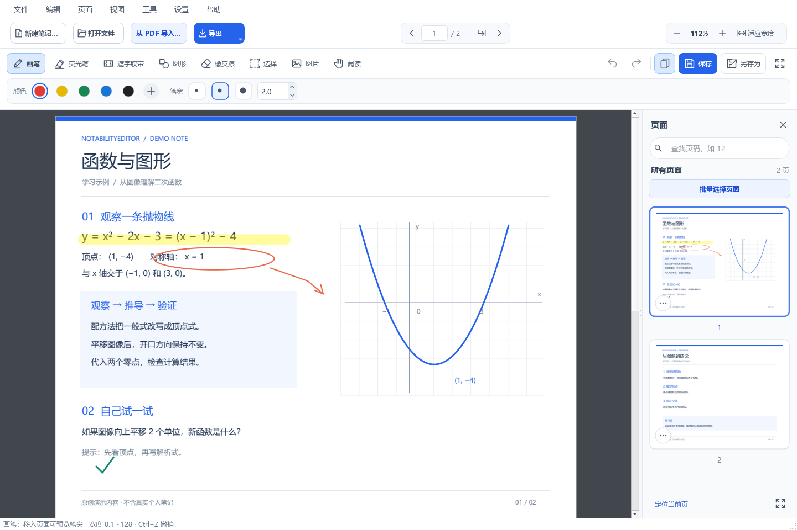
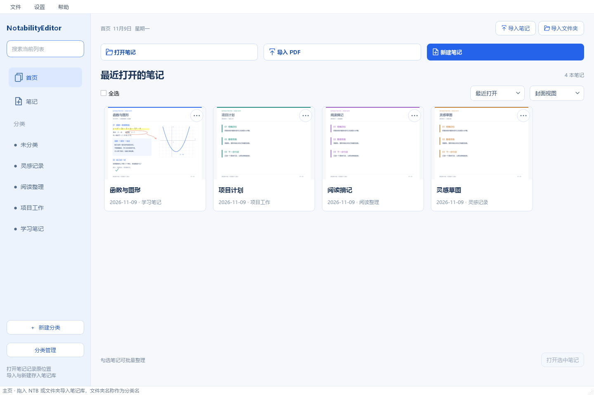
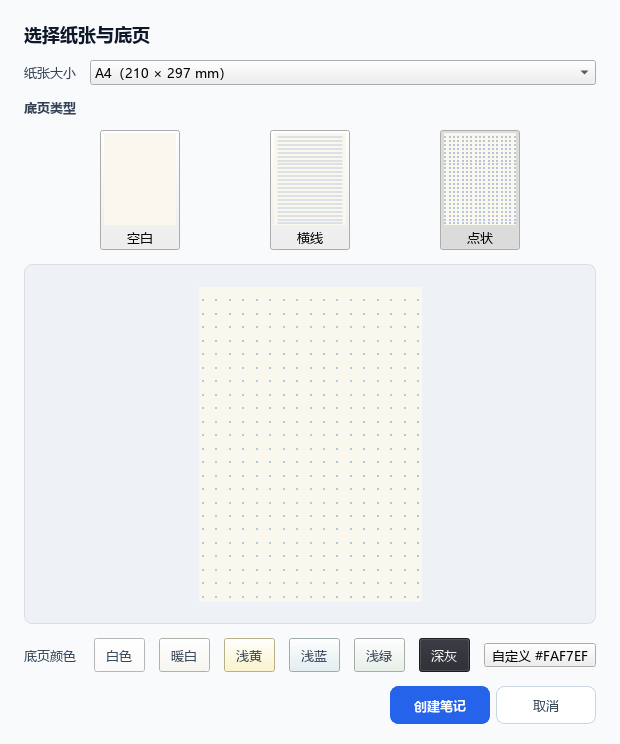

# NotabilityEditor

NotabilityEditor 是面向 Notability 笔记的本地阅读与编辑工具，支持 NTB 笔记编辑、NOTE 笔记阅读，以及 PDF 导入和导出。软件免费提供。

## 界面预览

以下为 NotabilityEditor 0.7.10-Beta 的实际界面，使用专门制作的原创演示笔记，不含真实个人笔记。

### 阅读与手写批注

导入 PDF 后，可在 NTB 笔记中添加笔迹、荧光标记与圈画批注；右侧缩略图便于浏览和切换页面。



### 笔记库与分类

在首页查看最近打开的笔记与封面，通过左侧分类整理学习、项目、阅读等不同主题。



### 自定义纸张与底页

新建笔记时选择纸张尺寸、空白／横线／点状底页与背景颜色，并实时预览效果。

<p align="center">
  
</p>

## 主要功能

- **笔记管理**：新建、打开和导入笔记，支持在首页拖入多个 NTB 或文件夹，也可点击“导入文件夹”，首页展示最近笔记，笔记页按分类分组；支持两级分类、分类管理、拖动及批量分类，按名称或路径搜索，使用封面或列表视图，支持全选、多选与移至回收站。
- **手写编辑**：画笔、荧光笔、遮字胶带、整笔及局部橡皮擦、矩形和自由选区、笔迹移动、选框四角拖动或输入百分比等比例缩放、撤销与重做。工具栏统一图标与文字间距，随窗口宽度自动换行。
- **图形绘制**：直线、箭头、矩形、椭圆、三角形和菱形，支持拖动预览、独立颜色与线宽；按住 Shift 约束比例或角度，按 Esc 取消。图形可选中移动、擦除、撤销、保存及导出 PDF，并记忆上次使用的图形设置。
- **页面与图片**：管理可编辑页面，插入图片，选择纸张尺寸、背景颜色及点阵／横线／空白底页，支持缩放、漫游、全屏及无缝跨页书写。全屏工具栏使用大图标与中文标签，可拖动到顶部、底部、左侧或右侧；拖动时虚线预览，松开确定，也可在“设置 → 全屏工具栏位置”中选择，重启后沿用最后位置。窄侧栏节省画布空间，侧边模式的撤销、重做、保存及页面管理集中在右上角。
- **格式转换**：导入 PDF 创建 NTB 笔记，导出 PDF 时保留原始页面尺寸并同步缩放背景和笔迹；NOTE 以阅读与导出为主。
- **保存与恢复**：后台保存、原子替换、外部修改冲突检查及本地恢复快照；异常退出后可恢复已落盘的编辑。
- **Windows 集成**：按需注册应用和设置笔记默认打开方式，在设置及帮助菜单中主动检查更新、前往发布页。
- **本地触控工作台**：通过浏览器与本机服务打开和编辑 NTB，支持快照、保存、下载及 PDF 导出；当前不提供原生 Android 安装包。

分类栏空白处右键可新建一级分类，右键一级分类可新建二级分类；在“分类管理”中可重命名、移动和移除分类。拖动笔记到左侧分类即可整理，勾选多本后可批量拖动。

分类和笔记索引保存在 `%LOCALAPPDATA%\NotabilityEditor\home-library.json`，导入副本及新建笔记默认保存在该目录下的 `library` 中，恢复数据位于 `recovery` 中。直接打开的外部笔记保留原路径；导入笔记会创建副本。备份时请同时保存索引与实际笔记文件。

## 启动与部署

### 使用 Windows 程序

解压下载的文件后运行 EXE。需要安装到当前用户目录、创建快捷方式或设置笔记打开方式时，使用“设置 → 注册应用到 Windows…”。有效注册版本等于或高于当前运行版本时，不再显示注册提醒。

免费软件告知需要在前台阅读满五秒后确认。检查更新仅由用户主动点击触发，不会自动下载或安装更新。

### 从源码启动

Windows 构建环境使用 x64 Python 3.11。进入项目根目录，在 PowerShell 中执行：

```powershell
py -3.11 -m venv .venv
.\.venv\Scripts\python.exe -m pip install -r requirements.txt
.\.venv\Scripts\python.exe main.py
```

依赖版本由 `requirements.txt` 固定。`main.py` 启动桌面主页和编辑器。

### 编译并安装

完整解压源码后双击 `INSTALL.bat`。它会调用 `deploy_windows.ps1`，准备 Python 环境、安装依赖、构建独立 EXE，并安装到当前用户目录及创建快捷方式。

默认安装位置为 `%LOCALAPPDATA%\Programs\NotabilityEditor`，构建产物位于项目的 `dist` 目录，部署日志位于 `deploy_logs` 目录。安装与注册使用统一版本比较，阻止旧版本覆盖较新程序；用户数据独立于程序目录保存。

### 启动本地触控工作台

安装依赖后执行：

```powershell
.\.venv\Scripts\python.exe tablet_server.py
```

服务默认监听 `127.0.0.1:8767` 并打开浏览器，可使用 `--port` 指定端口、`--no-browser` 关闭自动打开、`--data-dir` 指定工作目录。通过服务进入界面，不要直接双击 HTML 文件。

触控工作副本及恢复快照默认位于 `.tablet-data`，下载文件由用户选择保存位置。触控功能以 NTB 为主，已有图片和文字作为受保护内容显示，部分页面结构操作及 PDF 导入尚未接入。

## 源码架构

```text
项目根目录/
├── main.py                  # 桌面入口，组装主页、编辑器及启动流程
├── tablet_server.py         # 本地触控服务入口
├── core/                    # 软件身份、版本比较、几何和安全提交
├── document_core/           # 文档历史及不可变快照
├── formats/                 # NTB/NOTE 解析和原生格式写回
├── editing/                 # 笔迹、擦除、选区、撤销及保存恢复
├── import_export/           # 新建笔记、PDF 导入与导出
├── images/                  # 图片事件、几何和图层
├── pages/                   # 页面身份、能力校验及结构操作
├── rendering/               # 页面渲染、混合图层和缓存
├── ui/                      # 桌面主页、编辑页、菜单和工具栏
│   ├── home/                # 分类、笔记索引、卡片及批量操作
│   └── editor/              # 编辑视图容器
├── settings/                # 偏好、快捷键、启动提示和更新检查
├── platform_integration/    # Windows 安装、注册及用户数据迁移
├── infrastructure/          # 诊断和本地 AI 运行库
├── runtime/                 # 打包运行时钩子
├── rewritten/               # 触控后端、文件传输及编辑连接
├── android-tablet/design/   # 浏览器触控界面与共享控件
├── assets/                  # 图标、纸张模板和本地模型
├── tools/                   # 图标与诊断辅助工具
├── requirements.txt         # 运行依赖
├── INSTALL.bat              # Windows 一键部署入口
├── deploy_windows.ps1       # 环境准备、构建及安装脚本
├── VERSION_INFO.json        # 构建元数据
├── LICENSE                 # 原创内容许可
├── LICENSE_SCOPE           # 许可适用范围
├── THIRD_PARTY_NOTICES      # 上游与依赖声明
└── DISCLAIMER              # 免责声明
```

主要 Python 模块使用 `ne_` 文件名前缀。界面层负责展示与输入，格式层负责二进制解析和写回，文档及编辑层维护历史和快照；桌面与触控连接层调用共用处理引擎。

## 许可与免责

本项目有权授权的原创代码及文档使用 **0BSD** 许可，允许使用、复制、修改、商用和分发，无需署名。完整条款见 `LICENSE`，适用范围见 `LICENSE_SCOPE`。

源自上游 NotabilityViewer 的代码继续适用 MIT 许可；第三方依赖、模型和资源分别适用自身许可。0BSD 不会将全部源码或打包组件重新授权。来源及许可声明见 `THIRD_PARTY_NOTICES`。

软件按现状提供，不保证全部笔记格式或场景兼容。编辑、转换或覆盖保存前请备份原始笔记，并核对保存与导出结果。完整免责条款及适用法律限制见 `DISCLAIMER` 和 `LICENSE`。
